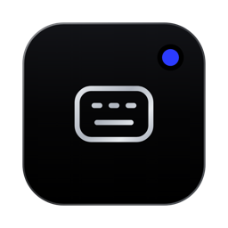

<p align="center">
  
</p>

<h2 align="center">1xKey</h2>

<p align="center">
  Bộ gõ đơn giản, tối giản, thuận tiện cho người Việt chỉ muốn gõ tiếng Việt chuẩn.<br>
  A minimal Vietnamese input method for macOS.
</p>

<p align="center">
  macOS 12+ · Apple Silicon · Miễn phí, GPL-3.0 · <a href="https://1xag.com/key">1xag.com/key</a><br>
  1xAg · /by_xuanhieu.org · 1xHieu · Confirmed: a true human
</p>

---

**Tiếng Việt** · [English](#english)

## Giới thiệu

1xKey là bộ gõ tiếng Việt trên thanh menu của macOS. Gõ thẳng, không gạch chân, không mất dấu trong Chrome, Claude, Slack hay terminal, và không gửi chữ bạn gõ ra khỏi máy.

Không có cửa sổ cài đặt. Menu chỉ gồm: bật/tắt tiếng Việt, chọn Telex hoặc VNI, thoát. Bảng mã luôn là Unicode. Bớt một việc, thêm một khoảng thở.

## Tính năng

| Vấn đề thường gặp | 1xKey xử lý |
|---|---|
| Gạch chân khi đang gõ (bộ gõ có sẵn của Apple) | Gõ thẳng, không gạch chân |
| Mất dấu trong Chrome, Electron, ô chat AI | Luật dựng sẵn cho ô địa chỉ, Google Docs, Word Online, Claude, ChatGPT, Gemini, Slack, Discord, Zalo, Teams, Messenger, terminal |
| Bộ gõ gửi dữ liệu ra ngoài | Đã bỏ hẳn Dịch, đồng bộ iCloud và tự cập nhật (Sparkle) |
| Log lộ chữ đã gõ | Log không ghi ký tự, mã phím hay đoạn chữ đã gõ |
| Phím tắt đụng app khác | Không có phím tắt toàn cục; bật/tắt từ menu |
| Quyền thừa | Chỉ cần Accessibility và Input Monitoring. Không iCloud, App Group, Apple Events hay quyền đọc thư mục |

Giữ phần lõi đã kiểm chứng của XKey và OpenKey: engine Telex/VNI, tự khôi phục khi gõ từ tiếng Anh, luật chống mất dấu theo từng app, tôn trọng Secure Input (ô mật khẩu). Các tính năng phụ (macro, kiểm tra chính tả, gõ tắt, nhớ ngôn ngữ theo app, thanh công cụ nổi) đều tắt cứng.

## Yêu cầu

- macOS 12 trở lên, Apple Silicon (M1 trở lên).
- Nguồn nhập **ABC**; không bật song song bộ gõ tiếng Việt của Apple.

## Cài đặt

1. Tải `1xKey-<phiên bản>.zip` tại https://1xag.com/key và giải nén.
2. Kéo `1xKey.app` vào **Applications** rồi mở. App chưa notarize: lần đầu vào **Cài đặt hệ thống → Quyền riêng tư & Bảo mật → Vẫn mở**.
3. Cấp quyền **Accessibility** và **Input Monitoring** cho 1xKey.

Tự build từ mã nguồn (cần Xcode đầy đủ):

```bash
sudo xcode-select -s /Applications/Xcode.app/Contents/Developer
./scripts/build-1xkey.sh
```

Kết quả ở `build/release.noindex/1xKey.app` kèm zip và sha256. Script ký bằng chứng chỉ "1xKey Code Signing (Pham Xuan Hieu)" nếu có, nên quyền giữ nguyên qua các lần build; không có thì ký ad-hoc, khi đó mỗi lần build lại phải xoá rồi thêm lại 1xKey trong Accessibility và Input Monitoring.

## Giấy phép

GPL-3.0. Xem `LICENSE` và `NOTICE` (ghi công XKey của xmannv và OpenKey của Mai Vũ Tuyên). © 2026 Phạm Xuân Hiếu.

## Quyền riêng tư

1xKey không thu thập, không lưu và không gửi chữ bạn gõ. Bản phát hành chỉ kết nối mạng một việc: mỗi ngày tối đa một lần tải tệp tĩnh https://1xag.com/notices.json để hiện mục "Thông báo" trong menu. Yêu cầu này không gửi chữ bạn gõ hay bất kỳ thông tin nào về bạn; trạng thái đã đọc lưu trên máy; mất mạng thì bỏ qua. Kiểm tra chính tả, tính năng có tải từ điển, bị tắt cứng. Cài đặt nằm trong `~/Library/Application Support/1xKey` (quyền 0700) trên máy bạn.

## Thay đổi

Xem [CHANGELOG.md](CHANGELOG.md) hoặc https://1xag.com/key/changelog.

## Tác giả

**1xHieu (Phạm Xuân Hiếu)** · Confirmed: a true human · [xuanhieu.org/gioi-thieu](https://xuanhieu.org/gioi-thieu) · mail@xuanhieu.org · Góp ý: https://1xag.com/key#gop-y

1xKey thuộc hệ sản phẩm [1xAg](https://1xag.com): One System. Infinite Possibilities.

## Sản phẩm khác của 1xAg

- [1xConvert](https://1xag.com/convert): giữ Shift kéo tệp trong Finder, thả vào định dạng muốn đổi.
- [1xSnap](https://1xag.com/snap): chụp một vùng màn hình, khoanh, ghi chú và dán ngay.
- Tất cả sản phẩm: [1xag.com](https://1xag.com)

---

## English

### What it does

1xKey is a Vietnamese input method in the macOS menu bar. It types straight through with no underline, keeps diacritics in Chrome, Claude, Slack and the terminal, and never sends what you type off your Mac. There is no settings window: the menu toggles Vietnamese, picks Telex or VNI, and quits. Encoding is always Unicode.

### Features

- Proven XKey/OpenKey engine: Telex and VNI, English-word auto-restore, per-app rules against lost diacritics, Secure Input respected.
- No translation, no iCloud sync, no auto-updater.
- Logs never record typed characters, key codes or quoted text.
- No global hotkeys. Only Accessibility and Input Monitoring permissions.

### Requirements

macOS 12 or later on Apple Silicon. Use the **ABC** input source; do not run Apple's Vietnamese input alongside.

### Install

1. Download `1xKey-<version>.zip` from https://1xag.com/key and unzip it.
2. Drag `1xKey.app` into **Applications** and open it. The app is not notarized: the first time, go to **System Settings → Privacy & Security → Open Anyway**.
3. Grant **Accessibility** and **Input Monitoring** to 1xKey.

Build from source with full Xcode: `./scripts/build-1xkey.sh`.

### License

GPL-3.0. See `LICENSE` and `NOTICE` (credits XKey by xmannv and OpenKey by Mai Vũ Tuyên). © 2026 Phạm Xuân Hiếu.

### Privacy

1xKey does not collect, store or send what you type. Release builds make one kind of network request: at most once a day they download the static file https://1xag.com/notices.json for the "Notices" menu item. It sends nothing you type and nothing about you; read state stays on your Mac; it is skipped when offline. Spell checking, which downloads a dictionary, is forced off. Settings live in `~/Library/Application Support/1xKey` (mode 0700) on your Mac.

### Changelog

See [CHANGELOG.md](CHANGELOG.md) or https://1xag.com/key/changelog.

### Author

**1xHieu (Phạm Xuân Hiếu)** · Confirmed: a true human · [xuanhieu.org/gioi-thieu](https://xuanhieu.org/gioi-thieu) · mail@xuanhieu.org

Part of [1xAg](https://1xag.com). Other products: [1xConvert](https://1xag.com/convert) (Shift-drag to convert files), [1xSnap](https://1xag.com/snap) (capture, mark up, paste), all products at [1xag.com](https://1xag.com).

<details>
<summary>Maintainers</summary>

- Version: `Version.xcconfig` (`MARKETING_VERSION`, `CURRENT_PROJECT_VERSION` as yyyyMMdd).
- App icon: 1xAg product icon (glyph `key`), built by `1xag-apply/brand-kit/product-icons/make-product-icons.mjs` + `make-icns.sh`; AccentColor is Cobalt Orbit #2B3BFF.
- No in-app updater. If one is added again, the feed path stays `https://1xag.com/key/appcast.xml`.
</details>
